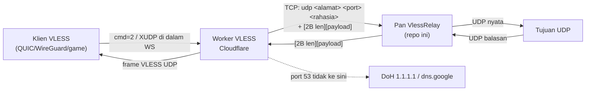

# Repository Guidelines

## Project Overview

`Pan-VlessRelay` adalah **relay UDP (TCP → UDP)** untuk worker VLESS milik
[CFVPN Hub](../cfvpn-hub). Alasan keberadaannya: Cloudflare Workers **tidak punya UDP keluar**,
jadi datagram UDP non-DNS (QUIC/HTTP3, WireGuard, game, NTP) diteruskan worker ke relay ini
lewat TCP, dan proses inilah yang mengirim UDP nyata ke tujuan. DNS **tidak** lewat sini —
worker menjawab port 53 sendiri lewat DoH (lebih cepat, tanpa hop tambahan).

Peran repo ini vs `cfvpn-hub`:

| | Pan-VlessRelay (repo ini) | cfvpn-hub |
|---|---|---|
| Isi | Server relay + Docker + uji mandiri | Worker VLESS (sisi klien relay) + panel |
| Peran | **target deploy** relay di VPS | pemakai relay + uji integrasi |
| Salinan relay | `relay/udp-relay.mjs` (kanonik) | `proxy-relay/udp-relay.mjs` (salinan, dipakai uji smoke) |

## Architecture & Data Flow



- **Satu koneksi TCP = satu sesi UDP ke satu tujuan.** Header dikirim sekali, lalu tiap
  datagram menjadi satu frame `[2B panjang BE][payload]` (dua arah).
- Relay membuat **satu soket UDP per sesi** dengan `sendto` ke tujuan; balasan dari tujuan
  dikirim balik dengan framing yang sama. Ini menghindari pola lama "satu koneksi relay per
  datagram" yang boros.
- Sesi ditutup saat klien menutup, rahasia salah, atau idle lebih dari `RELAY_IDLE_MS`.
- `health <rahasia>` dijawab `OK` lalu ditutup — dipakai `HEALTHCHECK` Docker, jadi tidak
  perlu port terpisah.

## Key Directories

| Path | Isi |
|---|---|
| `relay/udp-relay.mjs` | Server relay (ESM, tanpa dependensi npm) |
| `test/selftest.mjs` | Uji mandiri offline (health, bolak-balik datagram, rahasia salah) |
| `Dockerfile` | Image `node:22-alpine`, user `node`, healthcheck lewat protokol relay |
| `docker-compose.yml` | Menjalankan + restart + pengerasan (read-only, `cap_drop: ALL`, `no-new-privileges`) |
| `.env.example` | Dokumentasi semua variabel lingkungan |

## Development Commands

```bash
node test/selftest.mjs                 # uji mandiri, offline, tanpa Docker
RELAY_SECRET=rahasia-panjang node relay/udp-relay.mjs   # jalankan langsung

docker build -t pan-vless-relay .      # build image
docker run -d --name pan-vless-relay -p 7300:7300/tcp \
  -e RELAY_SECRET=rahasia-panjang pan-vless-relay        # jalankan
docker inspect --format '{{.State.Health.Status}}' pan-vless-relay
docker compose up -d --build           # kalau plugin compose tersedia
```

Mesin kerja (lihat juga `cfvpn-hub/AGENTS.md`):

- **PC Hermes:** `node` ada di `C:/Program Files/nodejs/node.exe` (**tidak** ada `node` di PATH
  shell, dan nama `nrun` tidak tersedia). **Docker tidak terpasang di PC.**
- **Laptop `laptop-debian`** (SSH): `node` ✓, **Docker 26.1.5** ✓ (paket Debian, **tanpa**
  plugin `compose` — pakai `docker run`, atau pasang `docker-compose-plugin` kalau mau compose).
  `systemctl start docker` dulu karena daemon-nya tidak aktif secara bawaan.

## Code Conventions & Common Patterns

- **Tanpa dependensi npm.** Hanya modul bawaan Node (`net`, `tls`, `dgram`, `fs`) supaya image
  kecil dan tidak ada rantai pasok yang perlu dipercaya.
- **Konfigurasi hanya lewat env** (lihat `.env.example`); tidak ada berkas config dan tidak ada
  argumen CLI. Rahasia tidak boleh punya nilai bawaan — kalau `RELAY_SECRET` kosong, proses
  menolak start.
- **ESM** (`.mjs`, `"type": "module"`), komentar & log berbahasa Indonesia, gaya `function`
  biasa (bukan kelas) seperti di `cfvpn-hub/frontend/source/*.js`.
- **Log:** satu baris per kejadian penting, diawali timestamp ISO (`log()`), tanpa pernah
  mencetak isi datagram atau rahasia. Statistik ringkas (`connections`, `denied`, `health`,
  `datagramsIn`, `datagramsOut`, `errors`) dicetak tiap 5 menit.
- **Ketahanan:** `uncaughtException`/`unhandledRejection` hanya dicatat, tidak mematikan proses;
  tiap sesi memakai `try`-nya sendiri dan `close()` yang idempoten. Datagram yang datang sebelum
  soket UDP selesai `bind` **ditahan** (`pending`) — pernah menjadi bug nyata yang menjatuhkan
  relay (`ERR_SOCKET_DGRAM_NOT_RUNNING`).
- **Batas:** `RELAY_MAX_DATAGRAM` (bawaan 8192) membatasi ukuran datagram; header maks 512 byte.
- **Protokol adalah kontrak.** `RELAY_PROTOCOL` (versi 1) dicetak saat start. Mengubah format
  header/frame **wajib** ikut mengubah sisi worker di `cfvpn-hub` (`udpRelayEnsure` /
  `udpRelayPipe` / `splitUdpDatagrams`) dan menaikkan versi.

## Important Files

| File | Kenapa penting |
|---|---|
| `relay/udp-relay.mjs` | Satu-satunya kode produksi; berisi parser header, manajemen sesi, sweep idle |
| `test/selftest.mjs` | Satu-satunya uji otomatis; menjalankan relay asli + UDP echo lokal |
| `Dockerfile` | Pengerasan + healthcheck; `EXPOSE 7300/tcp` (yang dibuka TCP, bukan UDP) |
| `docker-compose.yml` | Cara jalankan yang disarankan di VPS |
| `.env.example` | Sumber kebenaran variabel lingkungan |

## Testing & QA

- **Uji mandiri (`node test/selftest.mjs`)** — offline, keluar kode 1 kalau gagal:
  1. `health <rahasia>` menjawab `OK`;
  2. dua datagram berturut-turut pada satu sesi dijawab dua kali dan utuh (`UDP:HALO-1`, `UDP:HALO-2`);
  3. rahasia salah → koneksi ditutup **tanpa** satu pun datagram sampai ke tujuan (relay tidak
     boleh jadi alat refleksi UDP).
- **Uji integrasi relay ↔ worker** ada di `cfvpn-hub`: `nrun node tests/smoke-vpn-worker.mjs`
  menjalankan relay ini sebagai child process (dari `cfvpn-hub/proxy-relay/udp-relay.mjs`) +
  worker `wrangler dev` + UDP echo, lalu memastikan `worker → relay → UDP → balik sebagai
  datagram VLESS`. Salinan di sana **harus identik** dengan berkas di sini.
- **Verifikasi di Docker (laptop):**
  ```bash
  ssh laptop-debian 'sudo systemctl start docker'
  ssh laptop-debian 'cd /tmp && docker build -t pan-vless-relay <path>'
  ssh laptop-debian 'docker run -d --rm --name pvr -p 7300:7300/tcp -e RELAY_SECRET=uji pan-vless-relay'
  ssh laptop-debian 'docker inspect --format "{{.State.Health.Status}}" pvr'
  ```
- **Manual (tanpa Docker):** jalankan relay lalu kirim datagram dengan skrip kecil, atau pakai
  worker VLESS ter-deploy yang binding relay-nya sudah diisi.

## Hard Rules (non-negotiable)

1. `RELAY_SECRET` wajib; relay tanpa autentikasi **tidak boleh** dijalankan (risiko refleksi UDP).
2. Jangan pernah mencatat rahasia atau isi datagram ke log.
3. Satu koneksi hanya boleh mengirim ke tujuan yang tertulis di header pertamanya.
4. Batasi ukuran datagram; buang yang lebih besar tanpa melempar error.
5. Perubahan protokol wajib serentak di `cfvpn-hub` (worker) + naikkan `RELAY_PROTOCOL`.
6. Salinan `relay/udp-relay.mjs` di `cfvpn-hub/proxy-relay/` harus identik dengan berkas ini
   (cek: `sha256sum` di kedua sisi).

## Verify Before Claiming Done

```bash
node test/selftest.mjs                                  # 3 skenario PASS
sha256sum relay/udp-relay.mjs                           # bandingkan dengan cfvpn-hub/proxy-relay/udp-relay.mjs
docker build -t pan-vless-relay . && docker run --rm -e RELAY_SECRET=uji -p 7300:7300/tcp pan-vless-relay
```
